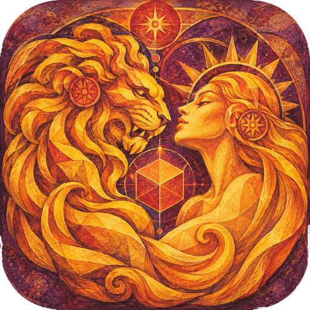

<p align="center">
  
</p>
<h1 align="center">
  
</h1>
<p align="center"><em><a href="README.md">Read in English</a></em></p>

Editor de cenas 3D simples e amigável ao toque, feito com [Babylon.js](https://www.babylonjs.com/).
Coloque seus modelos, posicione com o dedo ou o mouse, ilumine a cena e tire fotos com efeitos, no estilo do modo foto dos jogos.

A interface abre em inglês e pode ser trocada para português no menu de projeto (ícone de pasta).

## Rodar

```bash
npm install
npm run dev
```

Para testar no celular na mesma rede Wi-Fi: `npm run dev -- --host` e abra o endereço "Network" que aparece no terminal.

`npm run build` gera a versão final em `dist/`, que pode ser publicada em qualquer hospedagem estática. `npm run preview` serve essa versão localmente (use para testar o PWA: o service worker só funciona na versão final).

### Instalar como app (PWA)

O babalon JS é um Progressive Web App. Publicado em HTTPS (ou em `localhost`), o navegador oferece a instalação: ícone de instalar na barra de endereço do Chrome/Edge, item **Instalar app** no menu de projeto, ou *Adicionar à tela inicial* no Android/iOS. Instalado, ele:

- funciona offline (o app inteiro fica em cache; ambientes HDR e modelos de exemplo entram no cache na primeira vez que são usados);
- no computador, aparece em "Abrir com" para arquivos `.babalon`, `.glb`, `.gltf`, `.obj`, `.stl`, `.fbx`, `.ply`, `.splat` e `.spz`;
- no Android, aparece no menu **Compartilhar** do sistema: em qualquer gerenciador de arquivos (ex.: Meus Arquivos da Samsung) selecione um arquivo 3D ou um projeto `.babalon` → Compartilhar → babalon JS;
- mostra um botão **Atualizar** quando sai uma versão nova, em vez de recarregar sozinho.

## O que dá para fazer

- **Adicionar**: GLB, glTF, OBJ, STL, FBX, PLY/SPLAT/SPZ (gaussian splats), USDZ e .babylon, por botão ou arrastando os arquivos para a janela. Também há modelos de exemplo, formas básicas e luzes.
- **Posicionar**: toque para selecionar. Com *Mover*, arraste o objeto sobre o chão com o dedo/mouse, ou use os gizmos. *Girar* e *Escala* usam gizmos. O ímã liga o encaixe na grade.
- **Cena**: lista de objetos, ocultar/mostrar, sliders de posição/rotação/escala, girar 90° (útil para modelos "deitados"), pôr no chão, duplicar, excluir, animações do modelo.
- **Ferramentas**:
  - *Medir*: toque em dois pontos para medir. Os pontos grudam na superfície do modelo (e acompanham quando ele se move) ou caem no chão. A medida pode seguir a superfície do modelo em vez de ser uma reta. Encaixe em vértices, unidades m/cm/mm/in/ft, arraste os pontos para ajustar.
  - *Guias*: planos horizontais (altura) e verticais (X/Z) para alinhar coisas, posicionados por valor ou na base/centro/topo da seleção.
  - *Guias inteligentes*: ao mover, o objeto encaixa nas bordas e centros dos outros objetos, nas guias e no chão, no estilo do Figma.
  - *Alinhar e igualar* (2+ objetos, o primeiro selecionado é a referência): alinhar bordas/centros em cada eixo, igualar altura/largura/profundidade/escala, empilhar em cima, distribuir, pôr no chão.
  - *Tamanho*: campos de largura/altura/profundidade no painel Cena deixam o objeto com um tamanho exato.
- **Seleção múltipla**: Shift/Ctrl+clique, ou o botão de seleção múltipla em telas de toque. Mover, excluir e duplicar valem para todos os selecionados.
- **Material** (estilo Sketchfab): cor/tom, mostrar ou ocultar textura, metálico, rugosidade, verniz, emissão, opacidade, dupla face, sem iluminação e wireframe.
- **Luzes**: luzes prontas (Estúdio, Dia, Pôr do sol, Neon, Dramático), luz pontual, holofote e sol, com cor, intensidade, abertura, alcance, sombras e "mirar em".
- **Ambiente**: iluminação HDR com intensidade e rotação, fundo desfocado ou cor sólida, chão só de sombra ou sólido, grade.
- **Foto**: filtros prontos, campo de visão, exposição, contraste, saturação, temperatura, vinheta, bloom, granulado, aberração cromática, nitidez, desfoque de fundo (toque para focar), formatos 16:9, Cinema, 1:1, 4:5, 9:16… A foto sai em 2× a resolução da tela e é salva direto no aparelho, com um botão **Compartilhar** por alguns segundos.
- **AR** (Android com ARCore, no Chrome ou no app instalado): o botão **AR** abre a câmera; toque numa superfície detectada para colocar a cena inteira em tamanho real, arraste para girar, pinça para redimensionar (**1:1** volta ao tamanho real). O AR começa na configuração mais leve; o painel de opções liga sombras no chão real, os estilos de iluminação do editor (ou a luz estimada do ambiente), intensidade da luz, filtros de foto e um contador de FPS. O botão de olho esconde a interface. O botão de foto salva câmera + 3D quando o celular compartilha a imagem da câmera com o navegador; senão, use o print do sistema. Não disponível no iPhone (o Safari não tem AR via WebXR).
- **Projeto**: novo, abrir e salvar projeto `.babalon`. O arquivo é um .zip com `project.json` (objetos, transformações, materiais, luzes, animações, ambiente, efeitos e câmera) e os arquivos originais dos modelos em `assets/`. Modelos de exemplo ficam guardados só como link. Dá para abrir também arrastando o `.babalon` para a janela.
- **Salvamento automático** no navegador (IndexedDB): ao reabrir o app aparece "Continuar de onde parou".
- **Desfazer/refazer**, **exportar a cena como .glb**, tela cheia.

### Atalhos

| Tecla | Ação |
| --- | --- |
| W / E / S | Mover / Girar / Escala |
| F | Focar seleção (ou enquadrar tudo) |
| O | Orbitar em volta do objeto selecionado |
| M | Modo medir |
| P | Modo foto |
| Ctrl+Z / Ctrl+Y | Desfazer / Refazer |
| Ctrl+D | Duplicar |
| Ctrl+S / Ctrl+O | Salvar / abrir projeto |
| Delete | Excluir |
| Esc | Desmarcar / sair do modo foto |

Na câmera: arraste para orbitar, pinça/roda para zoom, dois dedos (ou botão direito) para mover. Toque duas vezes num objeto para focar nele, ou no chão vazio para orbitar em volta daquele ponto. O botão de órbita na barra de seleção torna o objeto selecionado o centro da órbita, sem mudar o zoom. Um pontinho dourado mostra o centro enquanto a câmera se move.

## Estrutura

- `src/editor.ts`: núcleo, sem interface. Cena, câmera, carregamento, seleção, gizmos, luzes, sombras, ambiente, pós-processamento, captura, exportação e histórico.
- `src/tools.ts`: medições (inclusive o caminho pela superfície), guias, guias inteligentes e alinhamento.
- `src/ar.ts`, `src/arHud.ts`: realidade aumentada com WebXR e os controles sobre a câmera.
- `src/project.ts`: salvar/abrir projeto (.babalon) e salvamento automático.
- `src/ui.ts`: painéis e barras, em DOM puro.
- `src/dom.ts`: helpers de interface (slider, toggle, cor, chips…).
- `src/i18n.ts`: traduções. As chaves são o texto em inglês; para outro idioma, basta adicionar um dicionário.
- `src/style.css`: tema escuro de vidro, com layout de celular abaixo de 760px.
- `vite.config.ts`: manifesto do PWA, cache offline e associação de arquivos.
- `public/icons`, `public/brand`: ícones e lettering do app, gerados a partir das artes em tamanho original em `design/`.

O objeto `editor` fica disponível no console do navegador para depuração.

## Licença

Copyright (C) 2026 Guilherme Holanda Sanches

Este programa é software livre: você pode redistribuí-lo e/ou modificá-lo sob os termos da GNU General Public License publicada pela Free Software Foundation, na versão 3 da licença ou (a seu critério) qualquer versão posterior. Veja [LICENSE](LICENSE).

As bibliotecas de terceiros mantêm suas próprias licenças: Babylon.js (Apache-2.0), fflate (MIT), ícones Lucide (ISC). Os modelos de exemplo e ambientes HDR são carregados em tempo de execução do CDN de assets do Babylon.js e não são distribuídos neste repositório.
